# Cryptosage

Cryptosage is a B.Tech research prototype for policy-driven post-quantum messaging. Local clients authenticate pinned ML-DSA identities, negotiate a permitted KEM and optional X25519 contribution, and exchange authenticated encrypted messages through a relay. A security lab and benchmark reports expose the protocol's behavior for examination.

## Problem statement

Harvest-now-decrypt-later attacks make the confidentiality lifetime of recorded traffic relevant before large quantum computers exist. Cryptographic agility lets a system change algorithms as standards and evidence evolve. This prototype studies those concerns using explicit policies and recorded experiments.

## Features

- Real liboqs KEMs and ML-DSA signatures, with experimental HQC requiring both policies to opt in.
- Signed negotiation, optional X25519 hybrid key agreement, negotiated AES-256-GCM or ChaCha20-Poly1305, directional ratchets and authenticated delivery receipts.
- Contact fingerprint pinning, encrypted local history, Keychain-backed storage on supported macOS profiles, and explicit recovery behavior.
- A local security lab, loopback relay observer, LAN demonstration mode and measured benchmarks.

## Architecture

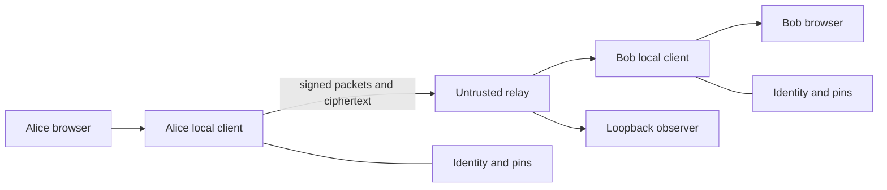

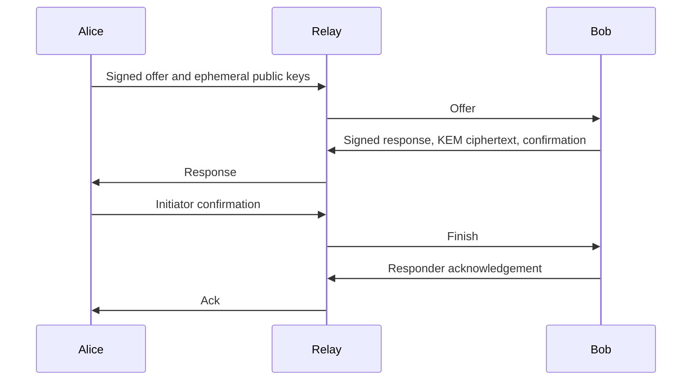

The relay sees routing metadata, public handshake fields and ciphertext. It verifies a public signature during registration and retains a first-seen key fingerprint for each name until restart. See [architecture](docs/ARCHITECTURE.md) and [security](docs/SECURITY.md).

## Screenshots

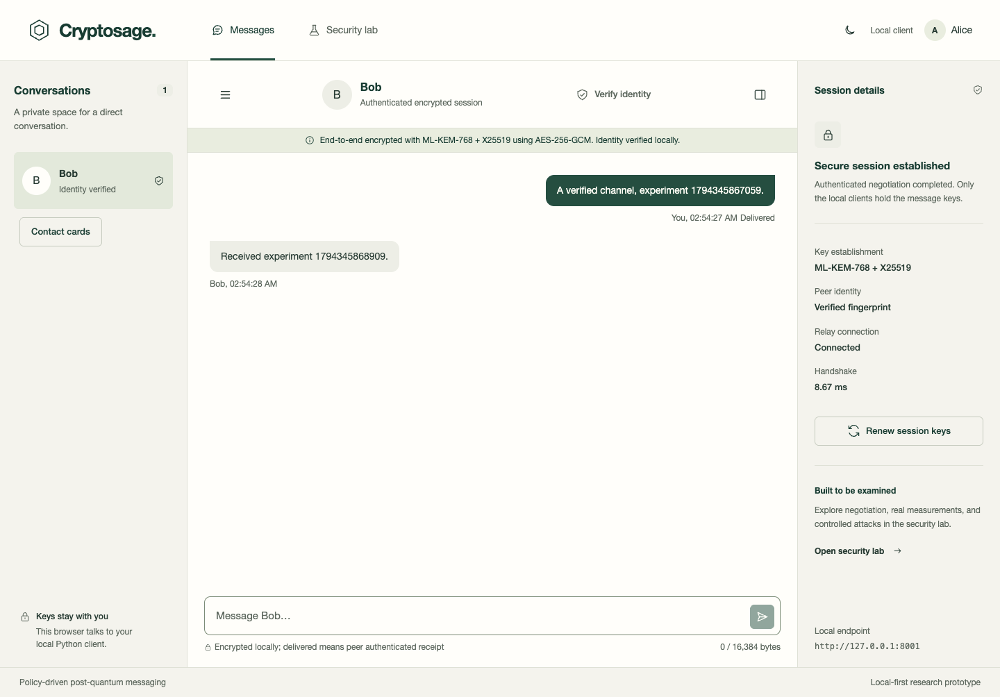
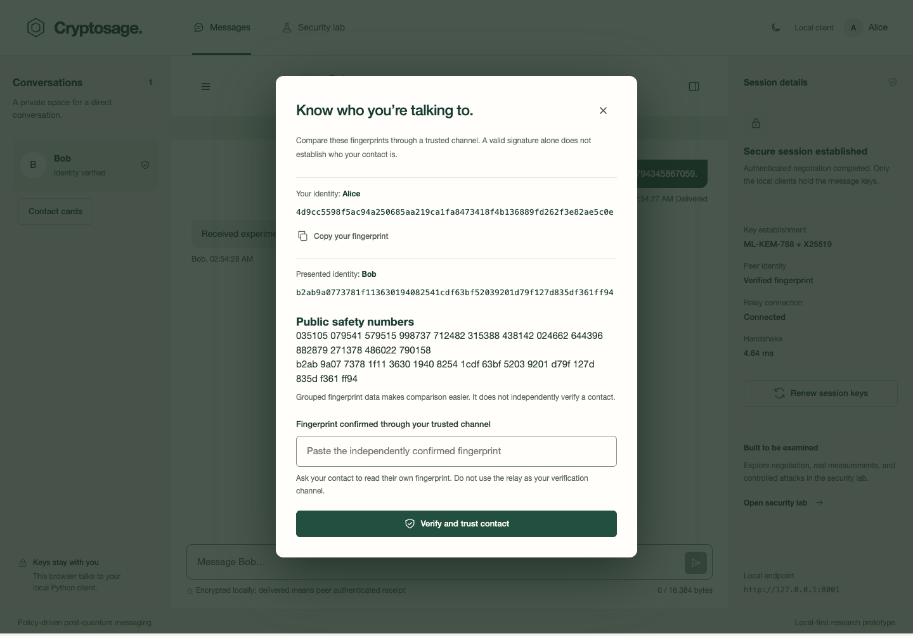
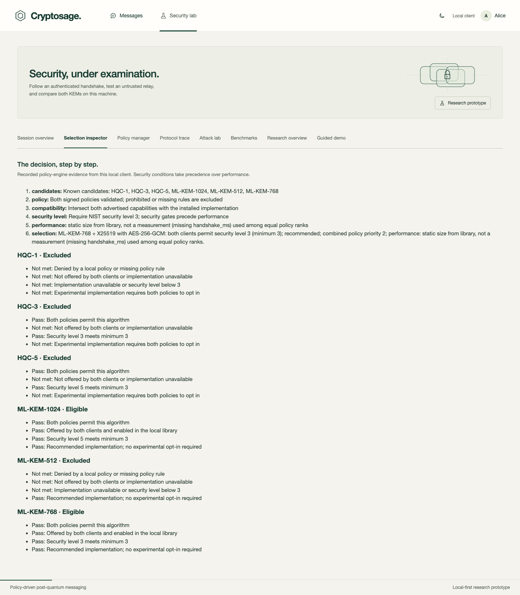
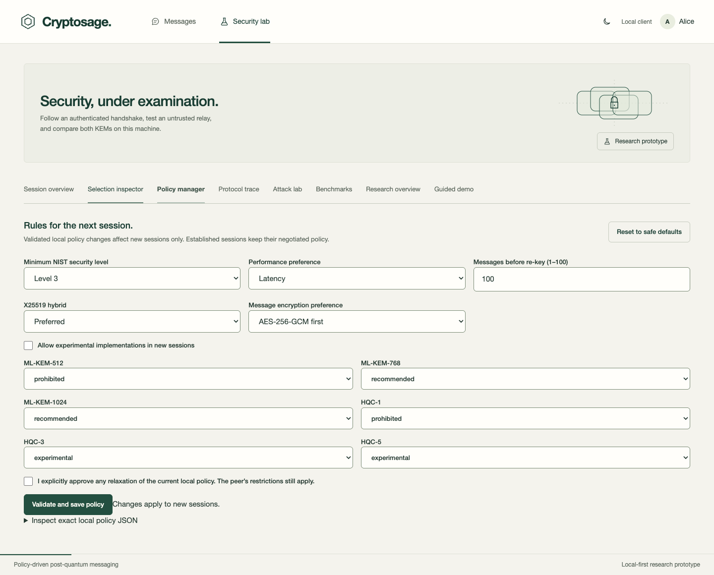
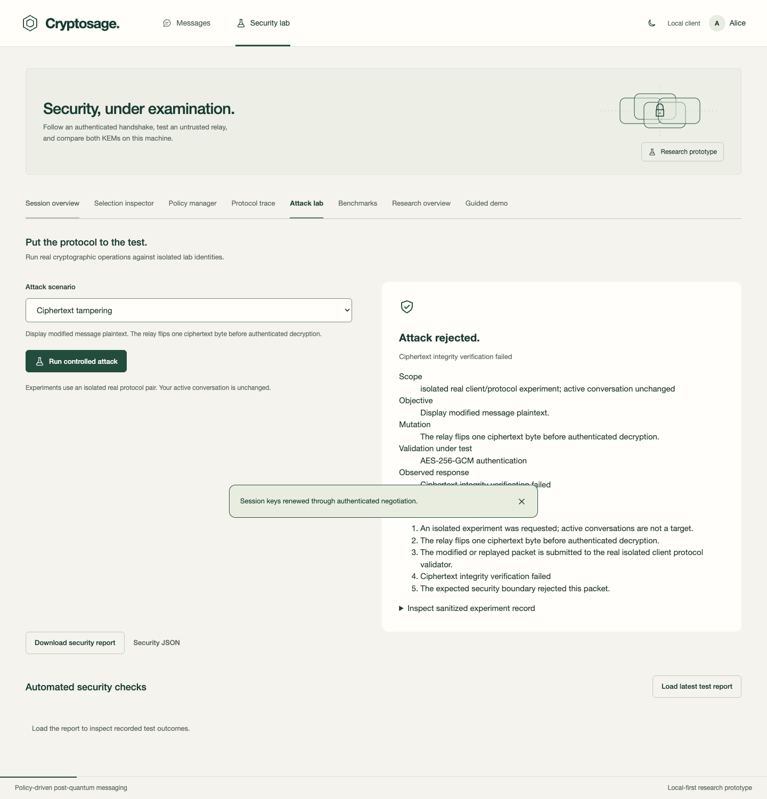
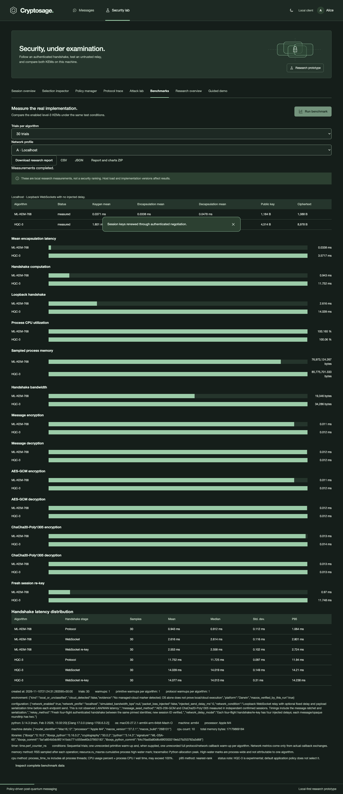
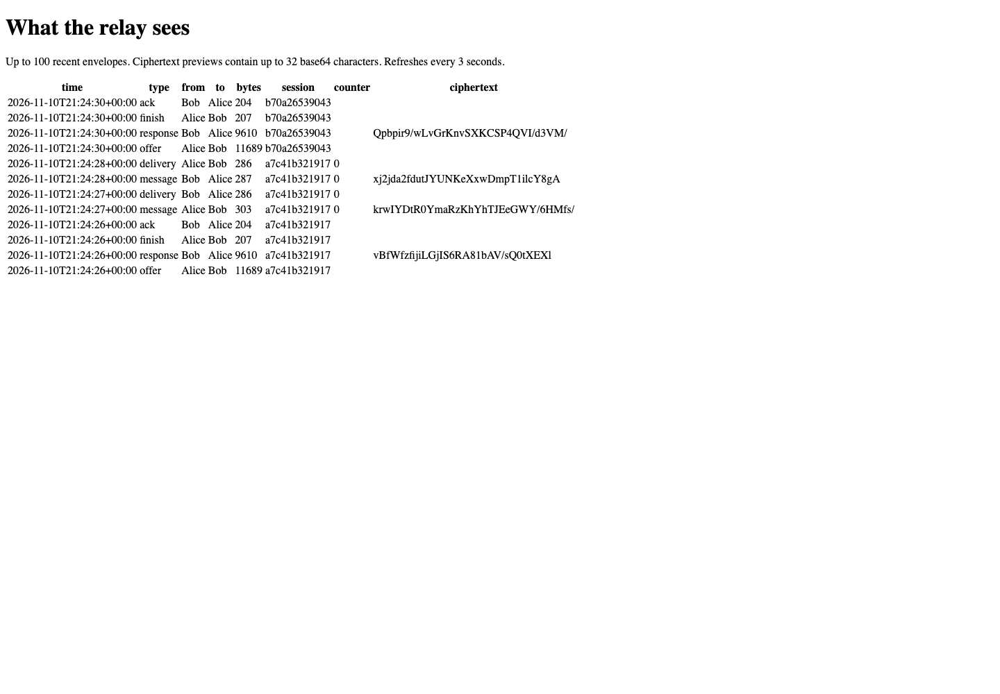
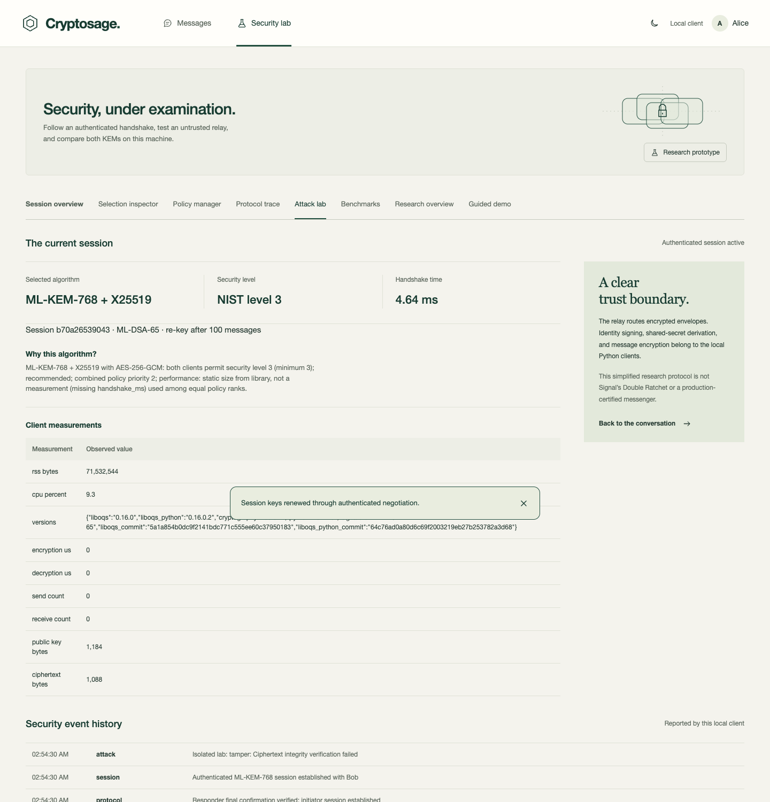
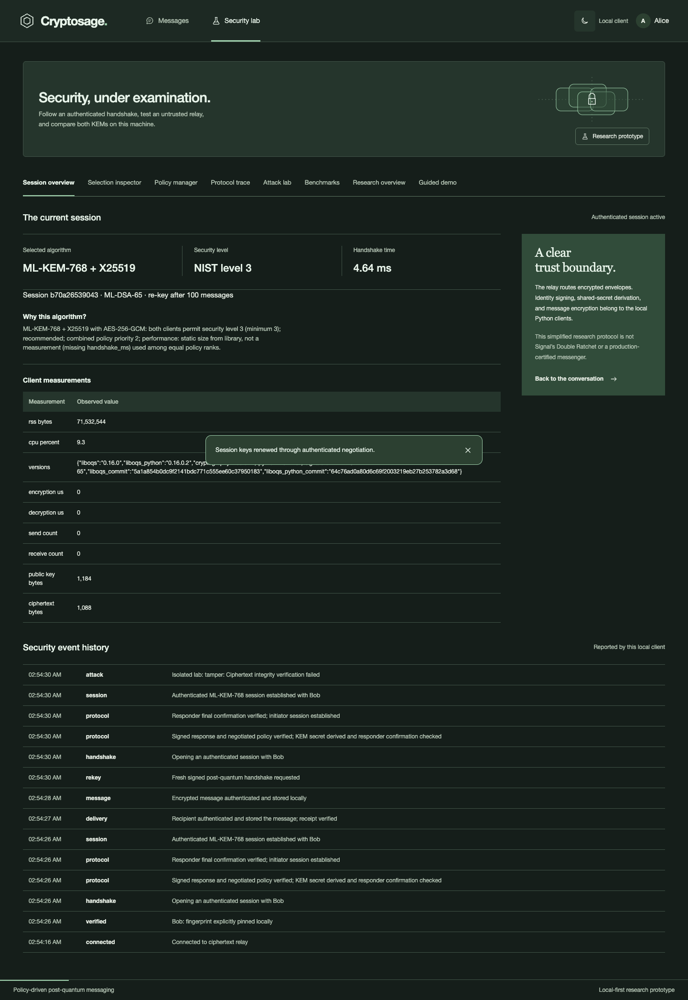

## Quick start

On macOS or Linux install Python 3.12 or later, Git and a C compiler, then run:

```sh
./scripts/setup.sh
./scripts/run_demo.sh
```

Open the printed Alice and Bob URLs. Compare the fingerprints through a trusted channel and pin them before connecting. Stop the launcher with Ctrl-C or `./scripts/stop_demo.sh`. The launcher also prints a loopback relay observer URL.

On Windows use WSL2 Ubuntu with the same commands. This path is documented, not tested. For separate machines see [the two-laptop guide](docs/TWO-LAPTOP-DEMO.md).

The separate [browser edition](https://crytosage.anshmaansingh.workers.dev/) runs cryptography in each browser and uses Cloudflare to route encrypted packets. It has a separate protocol and trust model described in [browser documentation](docs/BROWSER-DEMO.md).

## Recorded results

Measurements are from the recorded Apple M4 localhost run. The experiment includes both hybrid negotiation and actual loopback relay traffic. The computational handshake and network handshake are separate measurements.

| KEM | Public key bytes | Ciphertext bytes | Local handshake median / P95 ms | Loopback handshake median / P95 ms | Handshake bytes |
| --- | ---: | ---: | ---: | ---: | ---: |
| ML-KEM-768 | 1184 | 1088 | 0.906 / 1.010 | 2.583 / 2.813 | 19346 |
| HQC-3 | 4514 | 8978 | 11.557 / 12.096 | 13.824 / 14.373 | 34286 |

Source: [localhost/results.json](reports/final/localhost/results.json). The before-change handshake bytes are unavailable in the final evidence; no same-conditions comparison is claimed.

| KEM | AES-GCM encrypt / decrypt ms | ChaCha20-Poly1305 encrypt / decrypt ms |
| --- | ---: | ---: |
| ML-KEM-768 | 0.0105 / 0.0113 | 0.0120 / 0.0124 |
| HQC-3 | 0.0108 / 0.0114 | 0.0125 / 0.0125 |

Source: [localhost/results.json](reports/final/localhost/results.json). Medians include ratchet and serialization work.

[Selection scenarios](reports/final/selection-scenarios.md) explain policy decisions. [Moderate](reports/final/moderate/results.json) and [constrained](reports/final/constrained/results.json) results use injected delay and bandwidth constraints. They are simulated network conditions.

## Security and limitations

Fingerprint comparison establishes contact trust. The signed transcript binds policy, ephemeral keys and the selected algorithms. Directional message keys advance after successful operations. The relay can deny service, expose metadata, and accept the first identity to claim an unregistered name. Ordered delivery rejects out-of-order packets, and delivery receipts attest to client storage rather than human reading. The native and browser protocols are distinct.

The custom protocol has not received independent review or a formal proof. Endpoint compromise and Python secret erasure remain limitations. Multiple simultaneous conversations are future work.

## Project structure

- `crypto/`, `protocol/`, `policy/` implement primitives, handshakes and selection.
- `client/` and `server/` contain the local endpoint and relay.
- `attacks/`, `benchmarks/`, `tests/` and `reports/final/` contain experiments and evidence.
- `scripts/` and `docs/` contain launch tools and submission materials.

## Team, license and references

Team names, roll numbers and ownership are placeholders in [CONTRIBUTORS.md](CONTRIBUTORS.md). The project uses the [MIT License](LICENSE). liboqs is third-party MIT-licensed software. References and the full research discussion appear in [the report](docs/REPORT.md).
