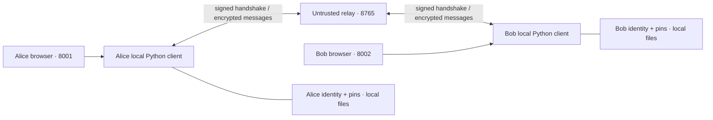

# Architecture and protocol

## Trust boundary

Each identity has its own Python process, local identity directory, ratchet state, and FastAPI UI endpoint. A browser on the same machine communicates with that local endpoint. The separate relay routes JSON envelopes over WebSockets and has no access to private identity keys, KEM secret keys, message keys, or plaintext through the protocol.



The relay sees identity names, timing, message type, packet length, and handshake public fields. It can delay, drop, reorder, replay, and alter traffic. Availability and metadata confidentiality are outside the protocol's guarantees.

The local web adapter checks Host, Origin, Fetch Metadata, and a per-process application token for state-changing requests. It serves a restrictive Content Security Policy and binds only to loopback. These controls address untrusted websites invoking local APIs. They do not protect against another malicious process running as the same operating-system user or a compromised browser/client.

## Identity

`protocol/identity.py` creates an ML-DSA-65 key pair on first use. `identity.json` is written atomically with mode 0600 inside a private directory. On later starts, permissive identity-file permissions are rejected. Its SHA-256 public-key fingerprint appears on the client's screen.

`trust.json` pins a contact name to an explicitly verified public-key fingerprint. The signature verifier checks this pin before accepting signed negotiation. A valid signature from a newly introduced identity does not establish that the signer is the intended contact. Unexpected identity changes fail; changing trust requires an offline, independently verified reset.

## Four-flight handshake

Protocol identifier: `crytosage/1`. The initiator generates a fresh random session identifier and nonce plus ephemeral KEM keys for its installed supported algorithms. Canonical JSON uses sorted keys and compact separators; signatures and transcript hashes use these bytes.

```mermaid
sequenceDiagram
    participant A as Initiator
    participant R as Untrusted relay
    participant B as Responder
    A->>R: Signed offer
    R->>B: Identity, session/version, nonce/time, policy/capabilities, measured profile, KEM public keys
    B->>B: Check pin/signature/replay; select permitted KEM; encapsulate
    B->>R: Signed response + responder key confirmation
    R->>A: Offer hash, responder identity/nonce/policy/profile, selected KEM, ciphertext
    A->>A: Check pin/signature/transcript/selection; decapsulate; check confirmation
    A->>R: Initiator key confirmation
    R->>B: MAC bound to transcript and initiator role
    B->>B: Check MAC; establish responder session
    B->>R: Final acknowledgement MAC
    R->>A: Transcript-bound acknowledgement
    A->>A: Check MAC; establish initiator session
```

The responder signs its complete response, including confirmation. That response contains the hash of the full signed-offer body, binding its identity, policy, capabilities, measurements, and KEM public keys. The transcript hash covers the offer and the response before confirmation/signature fields are attached. Both peers independently recompute the deterministic selection from the authenticated offers.

HKDF-SHA-256 derives a dedicated confirmation key from the KEM shared secret with the transcript hash as salt and the `crytosage/1/confirmation` domain. Separate `responder`, `initiator`, and `ack` MAC labels prevent reflection between flights. The initiator only establishes its session after the final acknowledgement. Pending handshakes expire after 30 seconds.

Offers have a timestamp freshness window, fresh random session/nonce values, and a bounded short-lived replay cache. Message counters reject duplicate ciphertexts. These mechanisms prevent recorded traffic from becoming an authenticated new session without the corresponding shared-key confirmations. The replay cache is in memory; it is not a permanent log across process restarts.

## Message ratchet

The shared secret and transcript hash derive a root through the `crytosage/1/root` domain. Separate `initiator-chain` and `responder-chain` domains establish the directional chain keys. For each message:

1. Derive a 32-byte AES key from the current chain using `crytosage/1/message-key`.
2. Encode the directional message counter as a 12-byte nonce.
3. Encrypt with AES-256-GCM. Authenticate version, session identifier, sender, recipient, and counter as associated data.
4. Advance the chain with the separate `crytosage/1/next-chain` domain.

Nonce values can repeat across directions because the directional keys differ. Each direction advances its key for every message, and a fresh session changes the transcript and initial chains. A failed decryption does not advance the receiving state or display plaintext.

This implementation accepts the next expected counter only. It rejects duplicates and future counters instead of retaining skipped message keys. A lost message therefore requires a fresh session to recover. It is a deliberately simple ordered channel over WebSockets.

## Re-keying

A manual **Renew session keys** action starts a new signed post-quantum handshake. Before a direction sends beyond 100 messages, the client performs a fresh handshake and waits for completion. Re-keying creates a new session identifier, ephemeral KEM secret, transcript and chains; it does not migrate algorithms inside the old session.

New sessions clear active old ratchet state. There is no delivery queue across a re-key or connection interruption. A simultaneous handshake attempt or an expired handshake needs a retry. These operational limitations are visible to the clients rather than treated as successful delivery.
