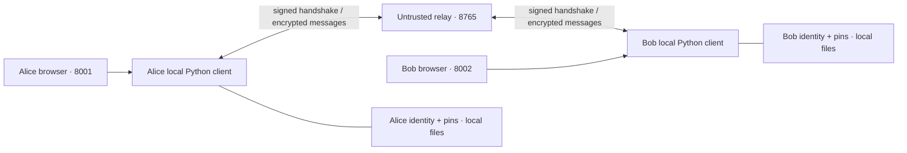

# Architecture and protocol

## Trust boundary

Each identity has its own Python process, local identity directory, ratchet state, and FastAPI UI endpoint. A browser on the same machine communicates with that local endpoint. The separate relay routes JSON envelopes over WebSockets and has no access to private identity keys, KEM secret keys, message keys, or plaintext through the protocol.

The native relay verifies one public ML-DSA-65 possession proof at registration. It binds a name to the first verified key fingerprint until the relay restarts. The challenge is fresh per connection. This limits replacement after first registration. It cannot establish who should own a previously unseen name. Clients still authenticate their contacts independently. The relay has no private key, session key or plaintext.



The relay sees identity names, timing, message type, packet length, and handshake public fields. It can delay, drop, reorder, replay, and alter traffic. Availability and metadata confidentiality are outside the protocol's guarantees.

The local web adapter checks Host, Origin, Fetch Metadata, and a per-process application token for state-changing requests. It serves a restrictive Content Security Policy and binds only to loopback. These controls address untrusted websites invoking local APIs. They do not protect against another malicious process running as the same operating-system user or a compromised browser/client.

## Identity

`protocol/identity.py` creates an ML-DSA-65 key pair on first use. `identity.json` is written atomically with mode 0600 inside a private directory. On later starts, permissive identity-file permissions are rejected. Its SHA-256 public-key fingerprint appears on the client's screen.

`trust.json` pins a contact name to an explicitly verified public-key fingerprint. The signature verifier checks this pin before accepting signed negotiation. A valid signature from a newly introduced identity does not establish that the signer is the intended contact. Unexpected identity changes fail; changing trust requires an offline, independently verified reset.

## Four-flight handshake

The native wire version is `crytosage/3`. Both peers need the same native wire version. The initiator generates a random session ID, a nonce, and one ephemeral key for each KEM its local policy admits. The browser edition uses a separate protocol. Canonical JSON uses sorted keys and compact separators; signatures and transcript hashes use these bytes.

```mermaid
sequenceDiagram
    participant A as Initiator
    participant R as Untrusted relay
    participant B as Responder
    A->>R: Signed offer
    R->>B: Identity, session/version, nonce/time, policy/capabilities, measured profile, KEM public keys, optional X25519 public key
    B->>B: Check pin/signature/replay; select permitted KEM; encapsulate
    B->>R: Signed response + responder key confirmation
    R->>A: Offer hash, responder identity/nonce/policy/profile, selected KEM, ciphertext, optional X25519 public key, hybrid flag and AEAD
    A->>A: Check pin/signature/transcript/selection; decapsulate; check confirmation
    A->>R: Initiator key confirmation
    R->>B: MAC bound to transcript and initiator role
    B->>B: Check MAC; establish responder session
    B->>R: Final acknowledgement MAC
    R->>A: Transcript-bound acknowledgement
    A->>A: Check MAC; establish initiator session
```

The responder signs its complete response, including confirmation. That response contains the hash of the full signed-offer body, binding its identity, policy, capabilities, measurements, and KEM and X25519 public keys. The transcript hash covers the offer and the response before confirmation/signature fields are attached. Both peers independently recompute the KEM, hybrid mode and AEAD selection from the authenticated offers. A capable side sends its ephemeral X25519 public key as 32 bytes encoded in base64. A side with hybrid mode off sends JSON `null`. Both sides must permit hybrid mode to use it. A required/off mismatch refuses the session. The initiator’s first mutually supported AEAD wins, and a disjoint list refuses the session.

For a hybrid session, HKDF-SHA-256 combines `KEM shared secret || X25519 shared secret`, with the transcript hash as salt and `crytosage/2/hybrid` as the info label. The output replaces the KEM secret as input to the confirmation and root derivations. This is the only new HKDF label. The version changes in signed and authenticated wire fields. Existing derivation, receipt, storage and relay registration labels retain their values.

HKDF-SHA-256 derives a dedicated confirmation key from the negotiated shared secret with the transcript hash as salt and the `crytosage/2/confirmation` domain. Separate `responder`, `initiator`, and `ack` MAC labels prevent reflection between flights. The initiator only establishes its session after the final acknowledgement. Pending handshakes expire after 30 seconds.

Offers have a timestamp freshness window, fresh random session/nonce values, and a bounded short-lived replay cache. Message counters reject duplicate ciphertexts. These mechanisms prevent recorded traffic from becoming an authenticated new session without the corresponding shared-key confirmations. The replay cache is in memory; it is not a permanent log across process restarts.

## Message ratchet

The shared secret and transcript hash derive a root through the `crytosage/2/root` domain. Separate `initiator-chain` and `responder-chain` domains establish the directional chain keys. For each message:

1. Derive a 32-byte AEAD key from the current chain using `crytosage/2/message-key`.
2. Encode the directional message counter as a 12-byte nonce.
3. Encrypt the random 16-byte logical message ID followed by UTF-8 text with the negotiated AES-256-GCM or ChaCha20-Poly1305. Authenticate the message type, version, session identifier, sender, recipient, counter and AEAD name as associated data.
4. Advance the chain with the separate `crytosage/2/next-chain` domain.

Nonce values can repeat across directions because the directional keys differ. Each direction advances its key for every message, and a fresh session changes the transcript and initial chains. A failed decryption does not advance the receiving state or display plaintext.

This implementation accepts the next expected counter only. It rejects duplicates and future counters instead of retaining skipped message keys. A lost message therefore requires a fresh session to recover. It is a deliberately simple ordered channel over WebSockets.

## Delivery and recovery

The sender records an attempt locally before transmission. The relay can report that it forwarded an envelope. That advisory event can set **Sent to relay**. The authenticated peer can issue a receipt only for the exact packet it consumed. The directional receipt MAC covers the session, sender and recipient, counter and packet hash. The recipient sends it after the local history and duplicate record commit.

An interrupted transmission, restart or receipt timeout can leave **Delivery unconfirmed**. The client discards the affected active session and asks the user to establish a fresh one. Retrying reuses the encrypted logical ID and original verified contact in a newly encrypted packet. The receiver keeps up to 4,096 IDs scoped to the pinned contact identity, with content hashes, in the same encrypted atomic record as history. A matching retry gets a new receipt without another message row. Conflicting content for a retained ID is rejected. History shows up to 500 messages. Restoring an old profile backup can roll both records back.

## Re-keying

A manual **Renew session keys** action starts a new signed post-quantum handshake. Before a direction reaches the negotiated limit of up to 100 messages, the client performs a fresh handshake and waits for completion. Re-keying creates a new session identifier, ephemeral KEM secret, transcript and chains; it does not migrate algorithms inside the old session.

A session expires after one hour or is replaced by a fresh handshake. Transport reconnects automatically when the relay returns. The user establishes a fresh authenticated session before sending. During a re-key, the current session remains usable until confirmation. After confirmation, peers send on the new session and can receive in-flight messages on the old one for up to 10 seconds. If both contacts initiate together, the lexicographically smaller identity name’s signed offer wins. An interrupted exchange can require a retry after the 30-second handshake timeout.

## Relay view and LAN mode

The default relay binds to loopback. An explicit LAN flag permits a LAN-facing relay while both browser UIs remain loopback-only. LAN WebSockets do not use TLS. See [Two-laptop demo](TWO-LAPTOP-DEMO.md).

The optional relay view serves a read-only page on a separate loopback port. It holds up to 100 recent envelope summaries in memory. Each includes the observed UTC time, type, routing names, size, session ID prefix, counter and a short base64 ciphertext preview where applicable. The relay neither decrypts nor verifies the message ciphertext. Fields sent by an arbitrary endpoint can be mislabeled.
