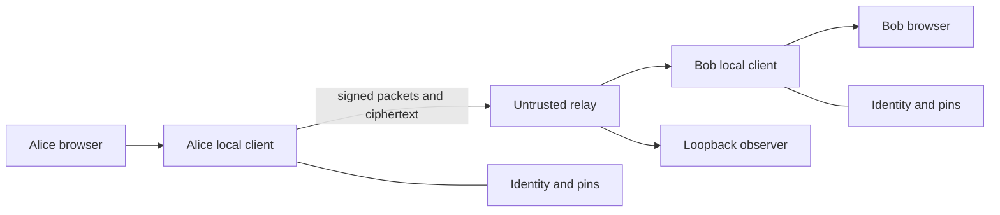
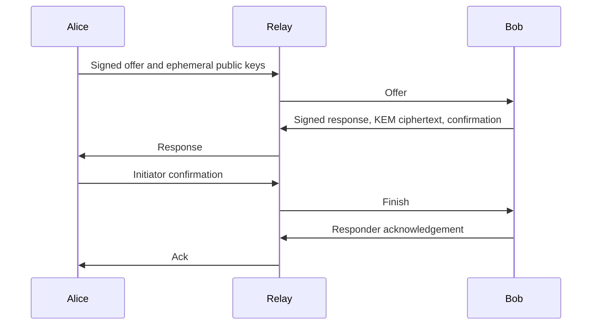
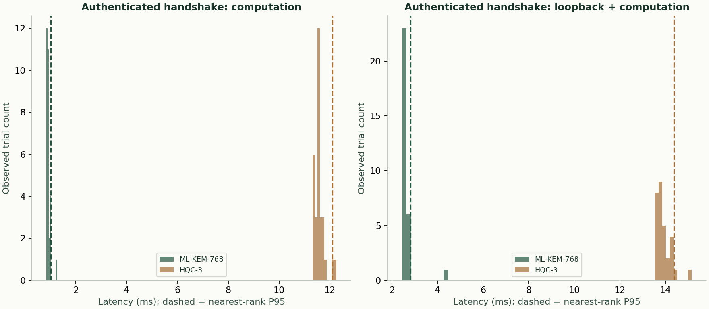

# Cryptosage B.Tech project report draft

## Abstract

Cryptosage investigates policy-driven cryptographic agility for authenticated post-quantum messaging. Separate local endpoints authenticate pinned identities, negotiate key establishment, derive directional message keys and communicate through an untrusted relay. Experiments exercise real cryptographic operations, transport and security validation. The prototype is a research artifact awaiting independent review.

## Introduction

Long-lived ciphertext may be collected before the attacker can decrypt it. A future cryptographically relevant quantum computer would change the risk to widely used public-key mechanisms. An adaptable design permits migration as implementations and standards mature.

## Literature review

Shor's algorithm gives a polynomial-time quantum approach to integer factoring and discrete logarithms. Grover's search provides a quadratic query advantage under its assumptions. NIST standardized ML-KEM and ML-DSA in FIPS 203 and FIPS 204. NIST selected HQC as a backup KEM using a different mathematical foundation. Cryptographic agility supports replacement when algorithms or implementations change. TLS hybrid key agreement and Signal PQXDH demonstrate different approaches to combining traditional and post-quantum contributions. Open Quantum Safe supplies implementations and research tooling. References are listed at the end.

## Problem statement and objectives

The project aims to authenticate participants, negotiate algorithms subject to both policies, protect messages from relay modification, make security decisions explainable, and measure real execution and network effects.

## System requirements

The native application needs a supported Python interpreter, C toolchain and the pinned liboqs build. Each endpoint needs local storage and a browser. The relay needs network connectivity to both endpoints. Fingerprint comparison requires an independent trusted channel. The optional LAN mode exposes metadata to the network.

## System design



### Threat model

The relay and network can observe, delay, drop, replay and modify packets. Endpoints and the local browser are trusted for the session. Contact pinning and signatures authenticate peers. Availability, traffic analysis, endpoint compromise, rollback and first registration of an unclaimed relay name are outside the demonstrated protections. [Security analysis](SECURITY.md) describes storage and operational limits.

### Protocol specification

The native protocol identifier is `crytosage/3`. Canonical JSON with sorted keys and compact separators is signed and hashed.

- Offer fields are `type`, `v`, `sid`, `from`, `to`, `identity`, `nonce`, `time`, `offer`, `kem_keys`, `x25519`, and `signature`. The nested offer contains algorithms, policy and measurement snapshots.
- Response fields are `type`, `v`, `sid`, `from`, `to`, `identity`, `nonce`, `offer_hash`, `offer`, `selected`, `x25519`, `hybrid`, `aead`, `ciphertext`, `confirmation`, and `signature`.
- Finish and acknowledgement contain `type`, `v`, `sid`, `from`, `to`, and `confirmation`.
- A message contains `type`, `v`, `sid`, `from`, `to`, `counter`, `aead`, and `ciphertext`. Its authenticated plaintext begins with a random logical message identifier.
- A delivery receipt contains `type`, `v`, `sid`, `from`, `to`, `counter`, `packet_hash`, and `confirmation`.



The hybrid input is KEM shared secret concatenated with X25519 shared secret. HKDF-SHA-256 uses the transcript hash as salt and `crytosage/2/hybrid` as info. Confirmation and root use `crytosage/2/confirmation` and `crytosage/2/root`. Directional chains use `crytosage/2/initiator-chain` and `crytosage/2/responder-chain`. Message keys and advancement use `crytosage/2/message-key` and `crytosage/2/next-chain`. Receipt keys use `crytosage/2/initiator-delivery` and `crytosage/2/responder-delivery`. These domain labels retain their existing spelling after the version bump.

Selection pseudocode:

```text
validate both policies and installed algorithms
intersect offered, installed, permitted and sufficiently strong candidates
exclude experimental KEMs unless both policies opt in
reject incompatible hybrid or AEAD settings
rank by experimental status and combined priority
compare available measured metrics or use library-reported static size
select deterministic minimum and record the reason
```

Re-keying creates fresh ephemeral secrets and a new session. The old session remains available during negotiation and briefly for in-flight receives after confirmation. Glare resolves by identity-name ordering. See [architecture](ARCHITECTURE.md) for registration, replay, delivery and nonce details.

## Implementation

| Module | Responsibility | Owner |
| --- | --- | --- |
| `crypto/` | Real native cryptographic primitives | <TEAM MEMBER> |
| `protocol/` and `policy/` | Handshake, ratchet and selection | <TEAM MEMBER> |
| `client/` and `server/` | Local UI, storage and relay | <TEAM MEMBER> |
| `attacks/`, `benchmarks/` and `tests/` | Evaluation and evidence | <TEAM MEMBER> |

## Testing

Unit and integration tests cover primitives, policy, storage, API boundaries, session behavior and real loopback clients. The attack lab reports outcomes from isolated experiments. The recorded suite contains 288 passing tests and one warning. Source: [test-summary.md](../reports/final/test-summary.md). The earlier coverage XML remains in local build evidence and was not included in the final report directory, so coverage is not stated as a submission result.

## Results and discussion

| KEM | Public key bytes | Ciphertext bytes | Local handshake median / P95 ms | Loopback handshake median / P95 ms | Handshake bytes |
| --- | ---: | ---: | ---: | ---: | ---: |
| ML-KEM-768 | 1184 | 1088 | 0.906 / 1.010 | 2.583 / 2.813 | 19346 |
| HQC-3 | 4514 | 8978 | 11.557 / 12.096 | 13.824 / 14.373 | 34286 |

Source: [localhost/results.json](../reports/final/localhost/results.json). The before-change handshake bytes are unavailable in the final evidence; no same-conditions comparison is claimed.

| KEM | AES-GCM encrypt / decrypt ms | ChaCha20-Poly1305 encrypt / decrypt ms |
| --- | ---: | ---: |
| ML-KEM-768 | 0.0105 / 0.0113 | 0.0120 / 0.0124 |
| HQC-3 | 0.0108 / 0.0114 | 0.0125 / 0.0125 |

Source: [localhost/results.json](../reports/final/localhost/results.json). Medians include ratchet and serialization work.


ML-KEM and HQC use different mathematical families and have different serialized sizes and computational costs in this build. These are observations for the recorded machine, implementation, configuration and trial set. The KEM-specific benchmark forces the chosen KEM in both policies. The before-change handshake-byte comparison was not recorded under matching conditions. Network profiles inject delay and modeled serialization time into loopback traffic, rather than measuring a physical WAN. Sources: [localhost](../reports/final/localhost/results.json), [moderate](../reports/final/moderate/results.json), [constrained](../reports/final/constrained/results.json).



## Security analysis

| Attempt | Defence | Test or experiment |
| --- | --- | --- |
| Negotiation change | Signed transcript and recomputed selection | `test_signed_selection_must_match_negotiation` |
| Identity substitution | Pinned identity fingerprint | `test_fingerprint_verification_and_changed_identity` |
| Message replay or tampering | Counter and AEAD authentication | `test_v2_catalog_exercises_real_rejection_or_secure_abort` |
| Changed relay registration key | First-seen relay binding | `test_relay_accepts_original_key_and_refuses_unverified_key_change` |
| Interrupted re-key | Disconnect cleanup and fresh session | `test_v2_catalog_exercises_real_rejection_or_secure_abort` |

The lab’s relay registration experiment checks a later key replacement. It does not establish who owns a previously unclaimed routing name. Source: [attack results](../reports/final/attack-results.json).

## Limitations

The protocol and hybrid combiner lack formal proof and independent cryptographic review. Relay availability and metadata are exposed. First registration is unauthenticated with respect to human identity. The ratchet handles ordered traffic only, duplicate records are bounded, and Python cannot guarantee complete secret erasure. The browser and native editions have different protocols. WSL and physical two-laptop operation remain untested in this evidence.

## Future work

Independent cryptographic review, formal state-machine analysis, better secret isolation, bounded out-of-order handling, multi-contact sessions, and physical network experiments are future work.

## Conclusion

The project demonstrates a policy-driven prototype with real post-quantum cryptography, explicit trust decisions, measured experiments and an observable relay boundary. Its recorded checks support the exercised behaviors while leaving protocol assurance and deployment hardening for further study.

## References

- P. Shor, “Algorithms for quantum computation: discrete logarithms and factoring,” FOCS proceedings, 1994. https://doi.org/10.1109/SFCS.1994.365700
- L. Grover, “A fast quantum mechanical algorithm for database search,” STOC proceedings, 1996. https://doi.org/10.1145/237814.237866
- NIST, FIPS 203, Module-Lattice-Based Key-Encapsulation Mechanism Standard. https://csrc.nist.gov/pubs/fips/203/final
- NIST, FIPS 204, Module-Lattice-Based Digital Signature Standard. https://csrc.nist.gov/pubs/fips/204/final
- NIST, “NIST Selects HQC as Fifth Algorithm for Post-Quantum Encryption.” https://www.nist.gov/news-events/news/2025/03/nist-selects-hqc-fifth-algorithm-post-quantum-encryption
- IETF, RFC 10024, Post-Quantum Traditional Hybrid Key Agreement Mechanisms for TLS 1.3. https://datatracker.ietf.org/doc/html/rfc10024
- Signal, The PQXDH Key Agreement Protocol. https://signal.org/docs/specifications/pqxdh/
- Open Quantum Safe, liboqs. https://github.com/open-quantum-safe/liboqs
